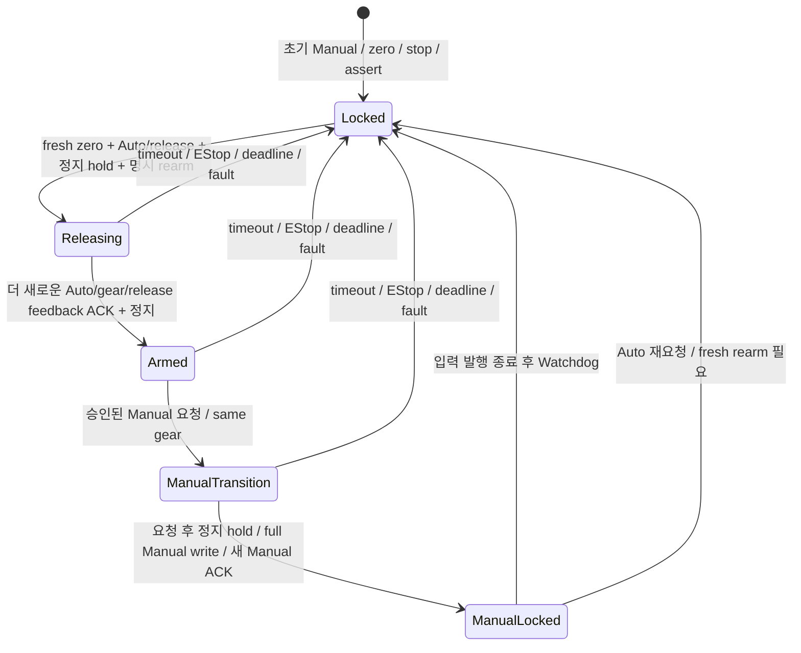

# ERP42 Manual → Auto → Manual 정지 상태 모드 전환 검증 계획

2026-10-10 KST / 실차 판정: **BLOCKED**.
범위는 코드 분석·격리 Mock 검증·절차 작성이다. 실차 명령 발행, 포트 접근, 노드 교체를 하지 않는다.
터미널별 읽기 전용 명령은 [MANUAL_AUTO_ROS_COMMAND_GUIDE.md](MANUAL_AUTO_ROS_COMMAND_GUIDE.md) 참조.

## 현재 실행 환경

읽기 전용 재조회: Master `http://localhost:11311`, node `/erp42_serial/erp42_serial_node`, PID5082/start tick28147,
exe `/home/autonav/ERP_2024/devel/lib/erp42_serial/erp42_serial_node`, private params는
serial_port=`/dev/ttyUSB2`, serial_baudrate=`115200` 두 개다. 현재 Drive/Mode publisher는 없다. `~rearm`도 없다.
실행 파일은 이전 드라이버이며, Working Tree의 새 안전 구현은 아직 배포되지 않았다.
PID는 다음 실행 시 다시 조회한다. 원본 바이너리/백업 동등성과 자세한 복구 기준은 [LIVE_ENVIRONMENT.md](LIVE_ENVIRONMENT.md).

기준 HEAD/backup=`bce6d56eb86ef60b78a2cc6483cfde9525229633`, master=`852d1bbfe090b5786597b7dfe21084f6b7b8dae9`.
현재 미커밋 파일이 소스 기준이며 backup HEAD만으로 새 안전 구현을 복구할 수 없다.

## 기존 / 신규 로직 비교

| 항목 | 기존 코드 사실 | 새 코드 사실 / Mock 검증 |
|---|---|---|
| Auto 요청 | ModeCallback MorA를 내부 값에 직접 대입; packet byte3로 송신 | Mode1만으로는 Locked에서 Auto가 되지 않음. 검증된 정책, fresh Auto/release Mode, zero Drive, healthy write, stationary hold 및 Trigger 필요 |
| Manual 요청 | MorA0도 같은 경로로 직접 대입; 별도 정지 인터록 없음 | Armed에서만 정상 ManualTransition; Manual gate/same gear/healthy write/fresh released EStop feedback 필요 |
| 초기 | Manual0/EStop0/Gear1/속도조향0/brake0 코드 | Locked, Manual0/검증된 initial gear/stop brake/assert EStop/0/0 |
| rearm | 없음 | 명시 Trigger success 뒤 Releasing. 새로운 mode/gear/release·stationary feedback가 와야 Armed |
| 정지/Brake | 입력 brake 무시, packet byte10=0 | 입력 brake validation 및 stop policy. Stationary는 비영 입력을 거부하고 Packet에서도 0/0 강제 |
| 명령 갱신 | 마지막 내부값 유지 가능 | 각 .25s Watchdog. Deadline도 별도 적용하며 rearm/입력 갱신으로 연장 안 됨 |
| Ctrl+C | Run 뒤 stop write 없음, destructor에서 Close | 정상 종료 stop write를 최대한 시도. SIGKILL·케이블 단절·write 실패에는 전달 보장 없음 |

기존 근거: `/home/autonav/ERP_2024_backup/src/erp42_serial/src/erp42_serial.cpp:54-71,139-179`,
백업 `include/erp42_serial.h:18-36,46-49`.
신규 근거: `src/erp42_serial/src/erp42_serial.cpp:40-59,78-98,100-122,124-139`,
`src/erp42_serial/src/safety_control.cpp:68-143,144-179,184-267`.
메시지 정의: `src/Total_msgs/ERP/ModeCmd.msg:4-7`, `DriveCmd.msg:4-6`.
백업 소스와 실행 바이너리의 전체 빌드 provenance 동등성은 UNKNOWN이다.
기존 packet 송신 코드의 Auto 조건 주석은 debug 출력 분기이며 Auto일 때만 전송하도록 제한하는 코드가 아니다.

## 상태 전이 및 관측

| 단계 | command / feedback 기대 | 확인 기준 |
|---|---|---|
| 초기 | command Manual0/assert/stop/zero; feedback Manual0 | 물리 Manual·정지, startup Locked 로그도 함께 확인 |
| Auto 요청 전 | Mode 입력 Auto1/release, zero Drive | 입력만으로 command Auto나 Armed가 되어서는 안 됨 |
| rearm 성공 | command Auto1/release/stop/zero | success는 서비스 승인이지 차량 ACK가 아님 |
| Auto ACK | 새 feedback Auto1/release/같은 gear·정지 | Armed 로그. feedback0→1 및 actual stationary 동시 확인 |
| Manual 요청 | 처음 Auto1/release/stop/zero | 이전 Drive 폐기, 요청 이후 stationary window 재시작 |
| Manual write | command Manual0/release/stop/zero | .3s hold 및 적어도2개 advancing-alive·동일 encoder sample |
| Manual ACK | full write보다 뒤의 새 feedback Manual0/release/정지 | ManualLocked 로그; 기존/중복 feedback0만으로 완료하지 않음 |
| 모든 입력 종료 | .25s 이후 Locked; 적용 Manual0 유지/assert/stop/zero | final command와 새 feedback 확인. ManualLocked가 영구 유지되는 것은 아님 |
| 후보 정상 종료 | bounded best-effort Manual0/assert/stop/zero write | final feedback는 종료 전에 받은 sample다. 종료 뒤 새 feedback 발행은 기대하지 않음 |

정상 경로 .25s Watchdog보다 .3s hold가 길어 Mode/zero Drive 갱신을 계속 유지해야 한다.
Manual 전체 timeout은1.0s이며 반복 요청으로 연장되지 않는다. deadline 만료·fault 뒤 Mode0 요청만으로 Manual 복귀하지 못한다.
Locked는 기존 적용 mode를 유지하므로 failure/Deadline 때 Auto1이 남을 수 있다.
Manual 요청 packet을 썼는데 실제 feedback가 Auto1인 경우에도 “Manual 복구 완료”로 표시하지 않는다.

**Auto ACK 전용 timeout은 현재 없다.** feedback 자체가 없으면 .25s feedback Watchdog가 동작한다.
하지만 fresh Manual feedback가 계속 들어오며 Auto ACK만 없는 경우 Releasing은 전체 Test Deadline까지 기다릴 수 있다.
운용자의 별도 단계 중단 기준과 충분한 남은 세션 예산이 필요하다. 실차 허용 시간 수치는 아직 UNKNOWN이다.
Mock 시험의1.5초는 합성 session budget이며 실차 사양이 아니다.

Mode·Drive는 별개 Topic이다. 기존 Control.cpp:419-420 발행 순서가 callback 순서를 보장하지 않는다.
새 callback은 Tick을 먼저 실행하고 fault 이후 fresh zero와 명시 rearm을 요구한다. timestamp 없는 메시지의 queued stale 여부는 검증 못 한다.
기존 Control.cpp:398의 Auto1 반복 발행과 :418의 brake1은 새 계약/Manual 반환과 충돌할 수 있다.
단일 발행자를 확인해야 하며 기존 Control/CAP/joystick ROS publisher를 모드 시험과 병행하지 않는다.

## 실차 필수 조건과 gate

| 조건 | 현재 근거 / 판정 |
|---|---|
| Manual·완전 정지 | 사용자 수동 관측 이력은 있으나 이번 작업에서 physical 상태 미확인. fresh feedback + 물리 관찰 필요 |
| 실제 바퀴 회전/차량 이동 방지 | UNKNOWN. 승인된 방호 방법과 안전 담당자 필요 |
| 독립 물리 EStop 및 실패 후 Manual 복귀 | 사용자 정지 관측과 ROS command/selector 우선순위는 다른 문제. 인터록·해제 후 정지 유지 미검증 |
| 구동 발행자 없음 | 현재 Master 조회에서 없음. 마지막 내부 명령 소거를 뜻하지 않음 |
| 포트 single owner | 최종 `/proc/*/fd` 검증 참조. 새 후보와 동시 실행 금지 |
| 이전 속도/조향 없음 | candidate restart Locked + stationary gate 소프트웨어 검증. 기존 운용 상태의 이전 값 소거는 UNKNOWN |
| Brake policy | release/stop/bounds의 Auto 명령 의미 및 실제 holding UNKNOWN |
| EStop policy | 사용자 feedback0/1은 관측 근거; startup/Auto command·해제 조건 UNKNOWN |
| Gear | 코드 D0/R2 사용 흔적과 Manual gear1 관측은 실제 의미/정지 인터록 증명 아님 |
| Manual return | 코드/Mock handshake는 검증. 물리 selector/Auto→Manual·brake 유지/통신 단절 대응 UNKNOWN |

`stationary_only=true`와 raw speed bound0은 출력0을 강제하지만 물리 무이동을 보장하지 않는다.
physical EStop을 무조건 풀거나 brake를 release0/stop37/200으로 가정하는 실차 명령은 제공하지 않는다.
Live launch flags는 protocol=false/hardware=false/manual-confirmed=false, stationary=true, deadline=-1이다.
stationary/deadline parameter를 기존 바이너리에 추가해도 기존 드라이버가 그 기능을 실행하는 것은 아니다.

## PHASE A~E 향후 진행/중단 계획

| Phase | 진행 조건/작업 | 중단 조건 |
|---|---|---|
| A 확인 | read-only Master/PID/exe/param/graph/feedback/owner + physical Manual·정지 | 예상외 mode/encoder/physical 움직임, node 식별 불가면 운용자에게 알리고 실제 명령 보류 |
| B 기록 | 새 bag 경로와 operator 사건 기록, command와 feedback 별도 비교 | 공간/기록 누락/기존환경 영향이면 시험 시작 보류 |
| C Manual→Auto | 검증된 candidate·profile/positive deadline·stationary/Manual gate·정지수단 및 복귀방법 승인 후 zero Drive/Auto Mode→explicit rearm→새 ACK/Armed | **현재 BLOCKED**. rearm 거절, ACK 없음, mode/gear/EStop 불일치, 센서 변화, 기간 부족 시 physical 보호 유지·중단 |
| D Auto→Manual | Armed 확인 후 same gear/released EStop/zero Drive를 갱신하며 Manual Mode 요청 | **현재 BLOCKED**. 1s software deadline/Watchdog/fault/새 ACK 없음이면 Manual 완료 아님. 독립 정지·physical Manual 수단 필요 |
| E 종료 | fresh feedback0와 physical Manual·정지 확인, 입력 종료 후 최종 fault-stop 조합도 검증, bag 저장 | 최종 assert+stop의 Manual 실차 효과 UNKNOWN. 확인되지 않으면 정상 종료 승인 불가 |

Manual 복귀와 장애 시 physical Manual 수단을 먼저 검증하지 않고 Auto 시험을 진행하지 않는다.
기한의 남은 예산을 충분히 확보한다. 서비스/ROS 시간 변화로 기한을 갱신하지 않는다.

## 실패 시 중단 / Rollback

1. 독립 물리 정지를 유지하고 신규 승인·전환·rearm 재시도를 멈춘다. 통신이 stop을 전달할 수 없을 수 있다.
2. command mode0와 feedback mode0, ManualLocked와 물리 Manual은 별개다. 하나라도 미확인하면 Auto 복구를 시도하지 않는다.
3. failure 시각/원인/PID/config/입력/command/feedback/rosout·bag를 새 증거 경로에 보존한다.
4. 후보 종료/원본 재실행은 별도 승인된 절차에서만 한다. 현재 PID5082와 Master는 이번 작업에서 건드리지 않는다.
5. 물리 Manual·정지 확보→후보 정상 종료→owner0 확인→검증된 기존 바이너리/두 params/메시지 환경 복원 순서.
6. old source launch가 새 소스로 변경돼 있으므로 그대로 재실행해 원본 설정을 복구한다고 가정하지 않는다.
7. 원본 복구 후에도 자동 운전 재개 금지. 기존 Brake 무시/Watchdog 부재가 복구되는 것일 뿐 안전성 보장이 아니다.

구체 rollback 명령 및 해시: [STATIONARY_VALIDATION_ROLLBACK_PLAN.md](STATIONARY_VALIDATION_ROLLBACK_PLAN.md) C절.
새 구현은 그 문서 작성 후 추가된 stationary/deadline 제한을 포함하므로 정책은 최신 SAFETY.md와 함께 확인한다.

## 검증 결과

최종 실행 결과와 보호 검증은 작업 완료 시 아래 표 및 [manual_auto_verification.json](manual_auto_verification.json)에 기록한다.

| 검사 | 최종 결과 | 증거 |
|---|---|---|
| offline / sanitizer | **85/85 및 85/85 PASS** | `/tmp/erp42-safety-zjwx7uuw/{safety-results,sanitized-results}.xml` |
| 이전 offline85 | 전부 유지, 누락0 | 이전 XML과 suite/name 비교 |
| 격리 ROS | **48/48 PASS** | `/tmp/erp42-ros-integration-fj89972c/integration-report.json` |
| 이전 ROS39 | 전부 유지·PASS | ROS-001~039 포함 확인 |
| 실제 장치 격리 | PASS | `isolation-probe.log`, node_audit namespaces/device_fds |
| 기존 환경 보호 | PASS | 9055 항목 content/mode/mtime 및 branch/index/remote/PID/params/final graph |

생산 C++/header/launch 변경 없음. 이번 수정은 test/run_ros_integration.py와 새 문서/결과에 한정된다.
기존85/85 source는 그대로 유지한 채 신규 workspace에서 재실행했다.
Test Master `http://127.0.0.1:53191`은 종료했고, 생성된 node/publisher child가 남아 있지 않음을 확인했다.
실제 node binary hash: `05ae83b9f894660b2586c9f6ee47130e9c68e6327763acd37b4b596f37c8262d`.
별도 build 디렉터리의 debug path가 달라 이전 시험 바이너리와 hash가 다를 수 있으며 현재 production source hash는 동일하다.

### 전체 sequence 실제 Mock feedback

| 단계 | Mock feedback MorA/EStop/Gear | speed/steer | Brake / Encoder |
|---|---|---|---|
| `startup_Manual_Locked` | 0 / 1 / 1 | 0.0 / 0.0 | 37 / -217 |
| `Auto_ACK_Armed_zero` | 1 / 0 / 1 | 0.0 / 0.0 | 37 / -217 |
| `Manual_ACK_ManualLocked_zero` | 0 / 0 / 1 | 0.0 / 0.0 | 37 / -217 |
| `all_inputs_stopped_watchdog_Locked_Manual` | 0 / 1 / 1 | 0.0 / 0.0 | 37 / -217 |

이는 합성 PTY feedback다. 물리 차량에서0→1→0이 확인됐다는 주장이 아니다.
startup/assert1 및 final/assert1은 Mock 정책이며 실차 EStop 명령을 승인하는 근거가 아니다.
`captures.json`의 transition_steps/commands/feedback/services/mocks와 node log를 함께 보면 각 단계와 모든14-byte 송신을 재확인할 수 있다.
서비스는 Topic을 우회한 core 직접 호출이 아니라 실제 ROS Trigger를 사용했다.

### 추가 실패 검증

| ID | 검증 및 결과 |
|---|---|
| ROS-040 | 전체 Manual→Auto→Manual→발행 종료 sequence 및 최종 stop packet: PASS |
| ROS-041 | Auto ACK 없이 fresh Manual feedback 유지, Releasing→deadline Locked: PASS |
| ROS-042 | Manual ACK 없이 fresh Auto feedback 유지, timeout Locked; command0/feedback1 불일치: PASS |
| ROS-043/044 | Manual 반환 중 Drive/Mode 갱신 각각 중단, Watchdog fault: PASS |
| ROS-045 | Manual 요청과 EStop assertion 동시 입력 우선순위: PASS |
| ROS-046 | zero와 brake1의 독립 전달 및 비영 legacy/brake 충돌의 stationary 거부: PASS |
| ROS-047 | ManualTransition 중 whole-session deadline; rearm 연장 거부: PASS |
| ROS-048 | 격리 ROS 발행자 child 실제 SIGKILL, node 생존 및 watchdog Locked: PASS |
| 기존 ROS-029/030/031/039 | Brake contract conflict·비영 입력·이전 주행 잔존 시도 차단 회귀: PASS |

완료 검증 도중 원본 Master에 `/rostopic_51872_1791636878506` feedback 구독자가 일시적으로 나타났다.
생성 주체는 UNKNOWN이며 이번 작업은 live feedback subscriber를 시작하지 않았다.
프로세스는 후속 조회 때 없어졌고 최종 Master graph는 시작 시점과 같았다. 해당 process에 signal/cleanup을 하지 않았다.
검증 JSON은 첫 graph 비교 false와 최종 비교 true를 모두 남긴다. 관측자 추가를 숨기거나 제거하지 않았다.

### 최종 판단

**BLOCKED**: 소프트웨어 sequence 및 실패 처리의 Mock 검증은 완료됐으나 Brake command/EStop 해제/Manual 인터록/통신 단절/독립 physical 정지 조건이 미확인이다.
실차용 pub/call/활성화 명령은 제공하지 않는다. 사용자에게 실행 가능한 부분은 조회·feedback 구독·bag 기록뿐이다.
다음 작업은 startup/final stop 조합과 Auto→Manual physical 복귀 수단 및 제동 계약 확인이다. 값이 확인된 뒤 별도 승인된
실차 stationary profile와 배포/rollback 검토를 진행한다. Mock PASS로 실차 PASS를 선언하지 않는다.
